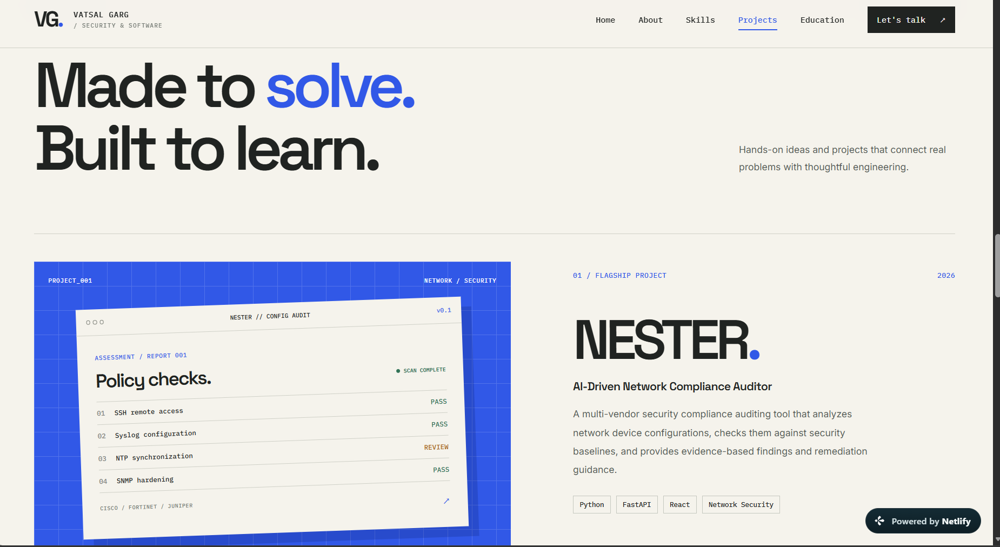

# Personal Portfolio | Vatsal Garg

A personal portfolio website showcasing my background as a B.Tech Computer Science (Cyber Security) student, technical skills, projects, education, and ways to get in touch.

## Live Website

**Visit the portfolio:** https://gettoknowvg.netlify.app/

## About the Project

This portfolio provides a single place to learn about me, explore my work, and connect with me. It is designed as a personal introduction for fellow students, collaborators, and potential recruiters.

## Key Features

- **Section-based navigation:** Browse Home, About, Skills, Projects, Education, and Contact sections.
- **Skills and project showcase:** View my technical interests, skills, and selected work.
- **Contact section:** Find information and links to connect with me.

## Technology Stack

- **Frontend:** HTML, CSS, JavaScript
- **Hosting and deployment:** Netlify
- **Version control and project documentation:** Git and GitHub

> Update this list if your actual source files use additional technologies or frameworks.

## Screenshots

Add at least two screenshots of the *working, deployed website* to a `screenshots/` folder in this repository, using the filenames below.

### Homepage

### Projects Section

> Replace these image paths if you use different filenames. The images will display on GitHub once they are uploaded to the repository.

## Run Locally

1. Download this repository as a ZIP file (or clone it with Git).
2. Extract the downloaded ZIP, if applicable.
3. Open `index.html` in a modern web browser.
4. Alternatively, use the **Live Server** extension in VS Code to preview the website locally.

> If your entry point is not `index.html` or your project has a build step, adjust these instructions to match your code.

## Testing and Validation

The following checks should be completed on the deployed website before final submission:

- [ ] Open the live link on a desktop browser.
- [ ] Test the portfolio on a phone or in responsive device mode.
- [ ] Verify section navigation and all external links.
- [ ] Verify the three main user actions (for example, navigating to projects, viewing skills, and opening a contact link).
- [ ] Check the browser console for errors and fix any issues found.
- [ ] Confirm that the deployed version matches the latest source files.

## Improvement Through GitHub

As part of Experiment 13, record one useful change based on feedback and implement it through a separate Git branch and pull request.

**Improvement made:** _Add your actual improvement here after completing it._

**Pull request:** _Add the merged GitHub pull request URL here._

## Known Limitations

_Review your live website and describe any genuine limitations here. If testing reveals no outstanding issues, write: “No known issues identified during the final verification.”_

## Deployment

The portfolio is publicly hosted on Netlify:

https://gettoknowvg.netlify.app/

For future changes, update the source code and deploy the revised version through the project's configured Netlify deployment method (Git-based deployment or manual upload).

## Author

**Vatsal Garg**  
B.Tech Computer Science Engineering (Cyber Security)  
JECRC University, Jaipur
