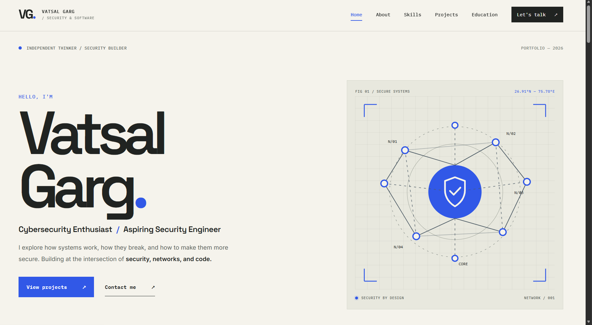

# Personal Portfolio | Vatsal Garg

A personal portfolio website showcasing my background as a B.Tech Computer Science (Cyber Security) student, technical skills, projects, education, and ways to get in touch.

## Live Website

**Visit the portfolio:** https://gettoknowvg.netlify.app/

## About the Project

This portfolio provides a single place to learn about me, explore my work, and connect with me. It is designed as a personal introduction for fellow students, collaborators, and potential recruiters.

## Key Features

- **Section-based navigation:** Browse Home, About, Skills, Projects, Education, and Contact sections.
- **Skills and project showcase:** View my technical interests, skills, and selected work.
- **Contact section:** Find information and links to connect with me.

## Technology Stack

- **Frontend:** HTML, CSS, JavaScript
- **Hosting and deployment:** Netlify
- **Version control and project documentation:** Git and GitHub

## Screenshots

### Homepage

### Projects Section

## Run Locally

1. Download this repository as a ZIP file (or clone it with Git).
2. Extract the downloaded ZIP, if applicable.
3. Open `index.html` in a modern web browser.
4. Alternatively, use the **Live Server** extension in VS Code to preview the website locally.

## Deployment

The portfolio is publicly hosted on Netlify:

https://gettoknowvg.netlify.app/

For future changes, update the source code and deploy the revised version through the project's configured Netlify deployment method (Git-based deployment or manual upload).

## Author

**Vatsal Garg**  
B.Tech Computer Science Engineering (Cyber Security)  
JECRC University, Jaipur
